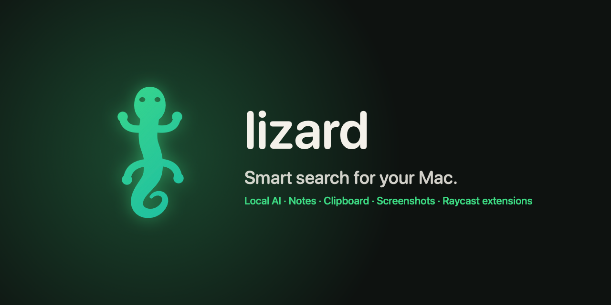

  <b>Lizard</b> is a fast, private, native launcher for macOS. 
  Apps, notes, clipboard, screenshots and windows — plus a local AI that knows your notes, 
  and Raycast-compatible extensions from any GitHub repo. One keystroke away.

  <code>brew install --cask get-lizard/tap/lizard</code>

  <a href="https://get-lizard.github.io/lizard/">Website</a> ·
  <a href="https://github.com/Get-Lizard/lizard">Source</a> ·
  <a href="https://github.com/Get-Lizard/lizard/blob/main/docs/EXTENSIONS.md">Build an extension</a>

- 🔒 **Private by design** — notes, clipboard, screenshots and AI stay on your Mac.
- 🧠 **Search by meaning** and **Ask your notes**, answered on-device with sources.
- 🧩 **Open extensions** — install from any GitHub repo; no store, no review queue.
- 🦎 Native Swift · macOS 26 · Apple Silicon · free
